<p align="center"><a href="README.md">🇪🇸 Español</a> · <b>🇬🇧 English</b></p>

<h1 align="center">🐕 LUIS LECI control: a SpotMicro on a Raspberry Pi 2</h1>

<p align="center"><b>A 3D-printed quadruped robot dog (a SpotMicro clone) that stands up, gallops, gives its paw and
"hails the bus", driven from a web app and from the TV, with no internet needed.</b></p>

<div align="center">
<table>
  <tr>
    <td colspan="3" align="center"><a href="https://youtu.be/Hf6u9rh6BYM">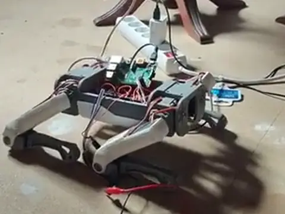</a></td>
  </tr>
  <tr>
    <td align="center"><a href="https://youtu.be/Hf6u9rh6BYM">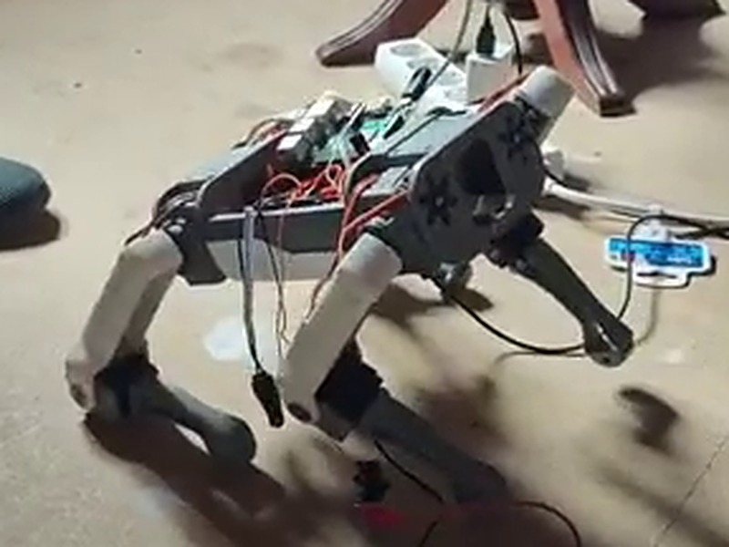</a><br><sub><b>1 · Stands up</b></sub></td>
    <td align="center"><a href="https://youtu.be/Hf6u9rh6BYM">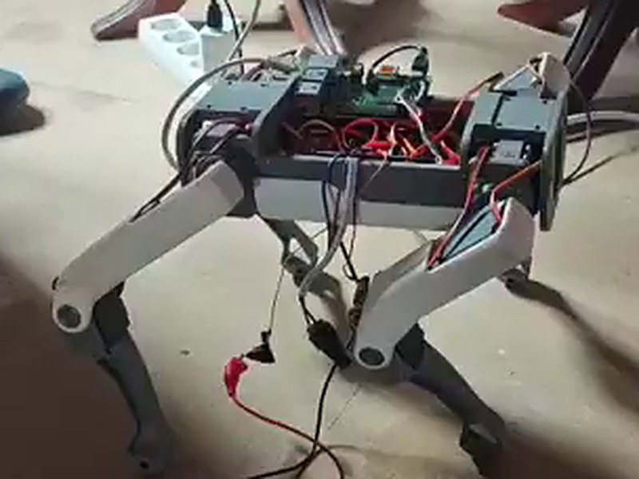</a><br><sub><b>2 · Wiggles its butt</b></sub></td>
    <td align="center"><a href="https://youtu.be/Hf6u9rh6BYM"></a><br><sub><b>3 · Gives its paw</b></sub></td>
  </tr>
  <tr>
    <td colspan="3" align="center"><a href="https://youtu.be/Hf6u9rh6BYM"></a></td>
  </tr>
</table>
</div>

> The interface and the in-repo docs are in Spanish (the robot's owner is Spanish); this page explains everything in English.
> Names used throughout: legs **A** front-left · **B** front-right · **C** rear-right · **D** rear-left; joints
> **1 pectoral** (abduction) · **2 hombro** (shoulder/hip) · **3 codo** (elbow/knee). "De pie" = standing,
> "Dar la pata" = give the paw, "Galope" = gallop, "Soltar todo" = release all.

---

## Contents

0. [For whoever continues the project (people and AI)](#0-for-whoever-continues-the-project-people-and-ai)
1. [What it is and what it does](#1-what-it-is-and-what-it-does)
2. [Hardware](#2-hardware)
3. [Wiring diagram and power](#3-wiring-diagram-and-power)
4. [Connecting to the robot](#4-connecting-to-the-robot)
5. [Legs and joints: how to tell which is which](#5-legs-and-joints-how-to-tell-which-is-which)
6. [Testing and calibration (±5, ±15, ±30…)](#6-testing-and-calibration-5-15-30)
7. [Standing up](#7-standing-up)
8. [Routines, gaits and stars](#8-routines-gaits-and-stars)
9. [Block programming (Scratch-style)](#9-block-programming-scratch-style)
10. [The TV (HDMI)](#10-the-tv-hdmi)
11. [Metrics: real-time current and power cuts](#11-metrics-real-time-current-and-power-cuts)
12. [Toreto mode and the Hz bar](#12-toreto-mode-and-the-hz-bar)
13. [Setting it up from scratch](#13-setting-it-up-from-scratch)
14. [Testing without the robot](#14-testing-without-the-robot)
15. [Lessons, problems and what's left](#15-lessons-problems-and-whats-left)
16. [Safety](#16-safety)
17. [Repository layout](#17-repository-layout)

---

## 0. For whoever continues the project (people and AI)

> **Continuing the project with an AI (GPT, Claude, Codex…)?** Start here: give it `AGENTS.md` and `docs/ESTADO.md`.

- [`AGENTS.md`](AGENTS.md): **read me first**. A self-contained summary with the golden rules, how to reach the robot,
  the architecture and how to work without breaking anything (meant to be pasted into GPT, Claude, Codex…).
- [`docs/ESTADO.md`](docs/ESTADO.md): where we are, where we're going, and what the star ratings taught us.
- [`docs/RUTINAS.md`](docs/RUTINAS.md) · [`docs/API.md`](docs/API.md) · [`docs/USAR-CON-GPT.md`](docs/USAR-CON-GPT.md).
- [`AYUDA.md`](AYUDA.md): the user guide (also in the web app, at `/ayuda`, and on the TV with the H key).
- [`CLAUDE.md`](CLAUDE.md): the long technical context and the **dated log** of everything done.

(These docs are in Spanish; any AI assistant can translate them on the fly.)

---

## 1. What it is and what it does

An inherited, half-built SpotMicro brought to life with a **Raspberry Pi 2** (no WiFi), a **PCA9685** servo board
and **12 MG996R servos**. All the software runs on the Pi and is driven from:

- 🌐 **A web app** (`http://<pi-address>`): map and calibrate the servos, move legs, poses, **80+ routines**
  (standing, gallops, giving the paw…), star ratings, Toreto mode, Hz bar, block programming, real-time current
  and a status report.
- 📺 **The TV over HDMI** with a keyboard: a text dashboard with the full status, **P** = stand up, routines by
  number, or the lightweight web app in kiosk mode.
- 🔌 **No internet or router needed**: with a network cable straight to a laptop the Pi is always at `169.254.42.1`.
- 🛡️ **Built for power cuts**: boot and brown-out log, atomic writes, watchdog and a heartbeat LED.

| What it already does | Code on the TV |
|---|---|
| Stand up (variant 6.7, the chosen one) | **P** or 10 |
| Give the paw while sitting (B and A, 4 versions) | 16, 47-49 · 96-99 |
| "Hail the bus": paw all the way up and a "ti-ti-ti" wave | 120, 121 |
| Galope fuerte · ritmo (the best walker, 5★) | 76 |
| Gallops, camel, kangaroo, draft horse, sideways… | 11-15, 30-46, 74-79, 101-106 |
| Horse gaits: walk, tölt, piaffe, passage… | 63-69 |
| Fun ones: dance, butt wiggle, pee, stretch | 80-84 |

---

## 2. Hardware

| Part | Details |
|---|---|
| Raspberry Pi 2 Model B v1.1 | armv7l, 1 GB, no WiFi or Bluetooth, powered over micro USB (5.1 V · 2.5 A) |
| PCA9685 | 16 PWM channels over I2C (bus 1, address 0x40); one burned out and was replaced with the spare |
| 12 × MG996R | analog servos, 3 per leg; designed for 50 Hz |
| Servo power supply | **5 V · 20 A** (the 5 A one fell short); 6 V would give ~15 % more torque |
| Capacitor | 1000 µF on the PCA9685 V+/GND terminal |
| TV over HDMI + USB keyboard | text dashboard and web app in kiosk mode |
| In the bag (not used yet) | 2 × HC-SR04 (the SpotMicro's "eyes"), HC-05 Bluetooth, 1602A LCD, NodeMCU ESP8266, spare PCA9685 |

---

## 3. Wiring diagram and power

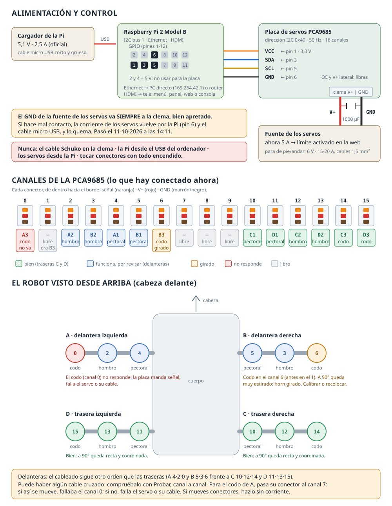

**Pi to PCA9685** (logic, 3.3 V): VCC → pin 1 · SDA → pin 3 · SCL → pin 5 · GND → pin 6.
**Servo supply to the PCA9685 V+/GND terminal**, with a common ground. Each servo connector, from the inside out:
signal (orange) · V+ (red) · GND (brown).

Rules learned the hard way:
- 🔴 **The servo supply's GND always goes to the terminal, screwed tight.** With a bad contact, the servo current
  returns through the Pi and its micro USB cable, and burns it (it happened).
- 🔴 **The Pi needs its own charger** (5.1 V, 2.5 A, short cable). With a weak one it boot-loops or shuts down
  abruptly when the servos move.
- 🔴 **Never** swap connectors with everything powered, feed another board from the servo terminal (that is how the
  first PCA9685 burned), or plug in the 230 V Schuko cable that came stuck in the terminal.

---

## 4. Connecting to the robot

| Situation | How |
|---|---|
| Network cable straight from the laptop to the Pi | Windows picks a 169.254.x.x address by itself → **`http://169.254.42.1`** · `ssh <user>@169.254.42.1` |
| Through a router (the Huawei 4G one) | DHCP, usually `http://192.168.8.104` |
| Last resort | fixed link-local IPv6: `ssh -L 8080:localhost:8080 <user>@fe80::ba27:ebff:fe16:ec15%<interface>` → `http://localhost:8080` |
| On the Pi itself | the TV over HDMI (dashboard or web kiosk) |

The web app listens on ports 80 and 8080. The **"estado"** tab (top right) tells you how you are connected, the IP
addresses, the SSH commands and the URLs. The NetworkManager profile (`spotmicro-eth0`) always keeps `169.254.42.1`,
with or without a router, and a **watchdog script** restores it every minute if anything breaks.

---

## 5. Legs and joints: how to tell which is which

Seen **from above with the head in front**: **A** front-left · **B** front-right · **C** rear-right · **D** rear-left.
Each leg, from the body to the ground: **1 pectoral** (opens/closes the leg sideways) · **2 hombro** (moves it
forward/back) · **3 codo** (bends the lower part). So **B3** is B's elbow.

| Leg | 1 pectoral | 2 hombro | 3 codo |
|---|---|---|---|
| A front-left | channel 4 | 2 | 1 |
| B front-right | 5 | 3 | 6 |
| C rear-right | 10 | 12 | 14 |
| D rear-left | 11 | 13 | 15 |

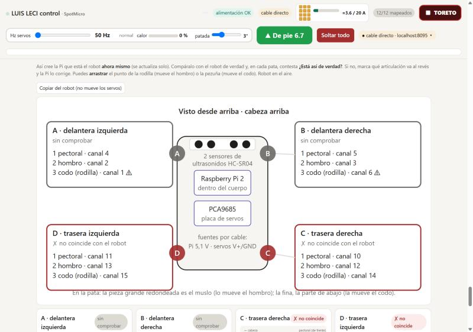

**To find which servo is on each channel**: press **Probar** (test) on its card and the servo moves ±10° and back.
The **"El robot en vivo"** (live robot) section draws what the Pi believes and asks "is it really like this?"; if a
joint turns the wrong way, one click inverts it.

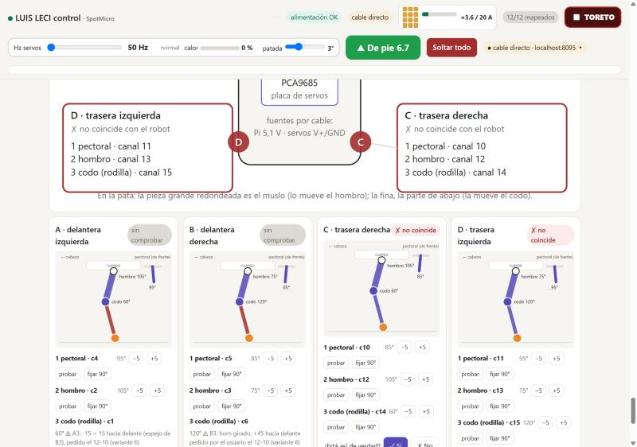

**Angles.** The web app works with **logical** angles (30-150°). The servo receives the logical angle plus its
calibration **offset**, clamped to 5-175°. The right-side legs are **mirrored** (180 − angle), and the direction of each
joint was found by trying all 8 combinations: the good one was "variant 6" (shoulder −, elbow +, front legs inverted).

---

## 6. Testing and calibration (±5, ±15, ±30…)

Each channel has a card with **Probar** (test), **Soltar** (release), **−30 −15 −5 +5 +15 +30** buttons, a slider and
**Calibrar** (set here = 90°, invert, clear offset). There are groups ("all pectorals / shoulders / elbows", mirrored
on the right side), "Bloquear todo donde está" (lock everything where it is) with a progress bar, and a memory of the
last position.

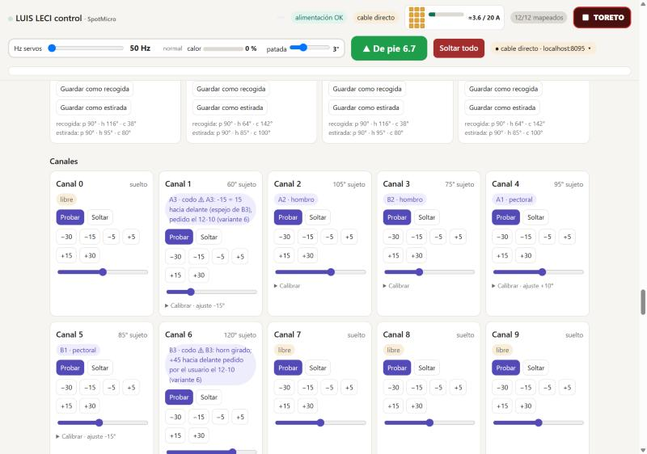

**Afinar patas** (fine-tune legs): with the robot standing, compare each leg with its pair (A with B, D with C) and
correct it ±1/±5. The servo moves right away and the offset applies to every pose and routine. Current offsets: A1 +10,
A3 −15, B1 −15, B3 +50 (horn mounted wrong: it hits its end stop), C1 −5, C3 −10, D3 −22.

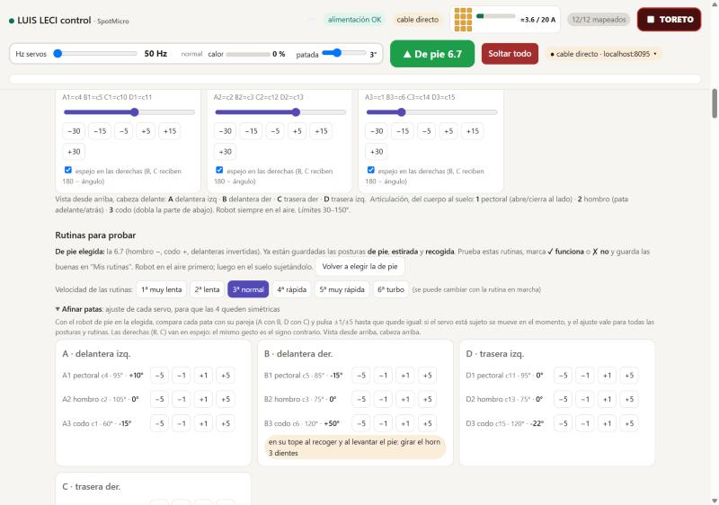

---

## 7. Standing up

Lifting the body with barely-strong-enough servos has a trick: if the servos move one at a time, each leg carries its
corner alone and can't make it. The stand-up routine **tucks all 4 legs together and extends them together**, 1° at a
time and slowly. The chosen stance is **6.7** (crouch 30, pectorals +5), with a big **▲ De pie** button at the top and
the **P** key on the TV (it stops whatever is running and stands up).

Variants to try: 6, 6.1 (low), 6.2 (high), 6.3/6.4 (tilted), 6.5/6.6 (pectorals), and the **gentle stand-ups** (in
steps, in two stages, and "Iván's": front and rear pairs alternating, never all 4 at once). Leg D is the weakest, so
they finish with a little "nudge" to its elbow.

---

## 8. Routines, gaits and stars

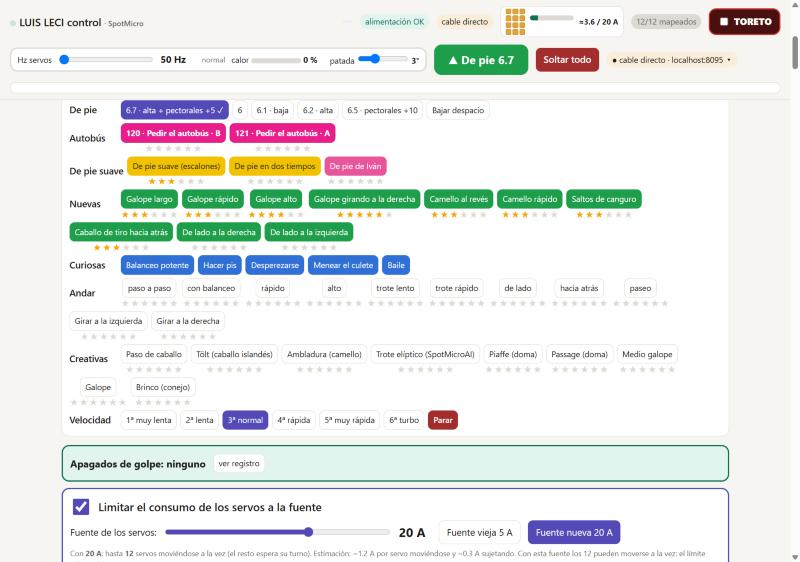

- **Phase-based gait engine** (like the SpotMicro projects on GitHub and horse gaits): each leg has its moment in the
  cycle; while on the ground it pushes from front to back, and in the air it swings forward in an arc. With a **firm
  footfall** (the foot presses into the ground, spot_mini_mini's "penetration depth"), clean lift-off, final push…
- **Speed** in 6 gears (1st very slow to 6th turbo), changeable while a routine runs. **Repeat forever** on any routine.
- **0-6 star ratings**: Luis rates every routine as he tests it, and the next ones are designed by crossing the best
  and changing one thing at a time (reinforcement learning by hand). What came out of it:
  - The **gallop family** walks (legs in the order D, C, A, B), best with straighter legs and a firm footfall.
  - An **asymmetric stride** works better (left legs long, right legs short).
  - **Lifting a front leg while standing tips the robot over**, because its weight sits at the front. **Sitting**
    works, which is how "Dar la pata sentado" (give the paw sitting) and "Pedir el autobús" (hail the bus) came about.
- **Coloured boxes**: gold (improvements on the best), silver (the winners and give-the-paw), red (Toreto), fuchsia
  (bus), yellow and pink (gentle stand-ups), green (new) and blue (fun).

Engine details and how to add a routine: [`docs/RUTINAS.md`](docs/RUTINAS.md) (Spanish).

---

## 9. Block programming (Scratch-style)

Blockly 13.3.0 served from the Pi itself (works offline), in Spanish: move a leg or joint, poses, wait, speed,
repeat, call another routine… Programs are saved as routines and can also be started from the TV (keys 1-9). Any
generated routine can be opened as blocks to look at or change it.

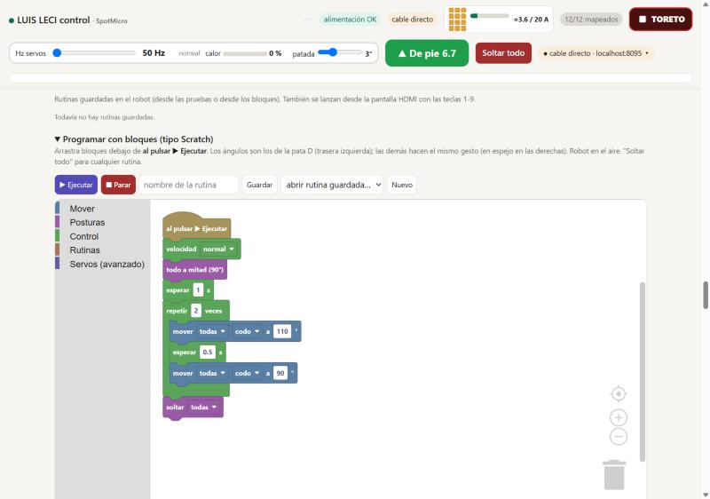

---

## 10. The TV (HDMI)

At boot there is a **15 s menu**: [1] text dashboard · [2] the web app in kiosk mode (cage + chromium) · [3] console.
The **dashboard** shows the 16 outputs with their pulse, the connection, the power, the current, the running routine
and the popular ones; it's driven from the keyboard:

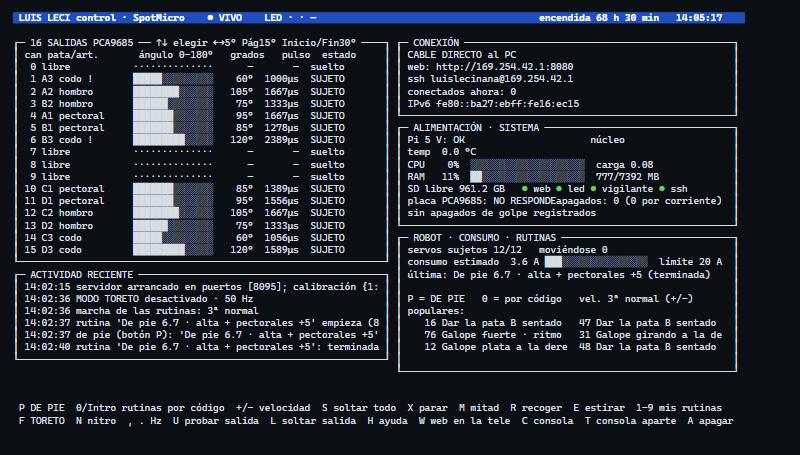

**P** stand up · **0 / Enter** routines by number (popular first, coloured by family, with stars) · **R** repeat
forever · **+ / −** speed · **F** Toreto · **N** Nitro · **, .** Hz · **X** stop · **S** release all · **H** help ·
**A/B** shut down or reboot.

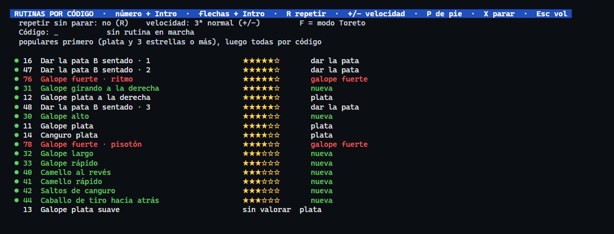

The **lightweight web app** `/lite` (the one the TV browser opens) has the essentials in big buttons:

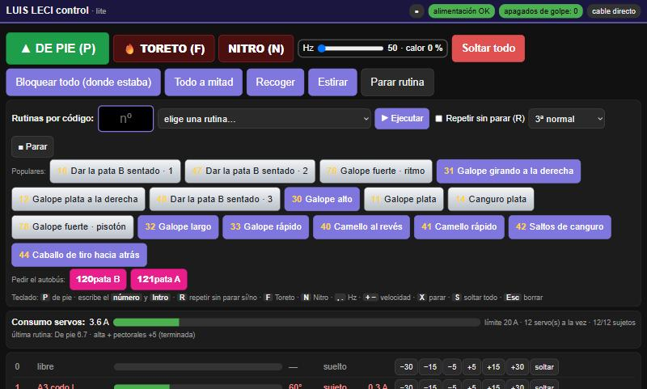

---

## 11. Metrics: real-time current and power cuts

- **Estimated current per servo**, every second, in the header (grey released · amber holding ~0.3 A · red moving
  ~1.2 A) and on the TV, against the **supply limit** (old 5 A / new 20 A supply): with a small supply it moves the
  servos in batches.
- **Estimated servo heat** with the Hz bar.
- **Sudden shutdowns**: a strip with every cut (power-related or not), taken from the persistent journal and from
  `energia.log`, which records every boot and every voltage drop.
- **Report** ("informe para la mudanza"): checks services, network, power, SD card, board, map and git at a glance.

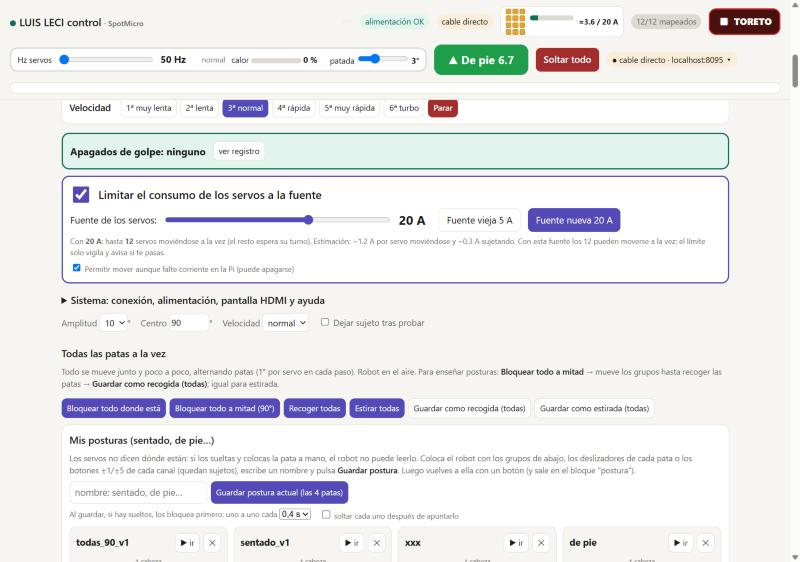

It's an **estimate**: measuring it for real would need a sensor (e.g. an INA219).

---

## 12. Toreto mode and the Hz bar

**Toreto** ("maximum power, like in Fast and Furious"): every move is a single jump, everything at once, with an
adjustable **kick** of a few degrees past the target so the servo puts in all its force. The kick only applies to
big moves (on the small gait steps it made the robot shake).

**Hz bar (50-200)**: more hertz give more torque and more heat. The Pi **estimates the servos' heat**: it rises while
they hold above 60 Hz and drops at 50 Hz. At 100 % it **goes back to 50 Hz by itself** and won't go up again until they
cool down. It also refuses to go up while the Pi is short on power.

<p align="center">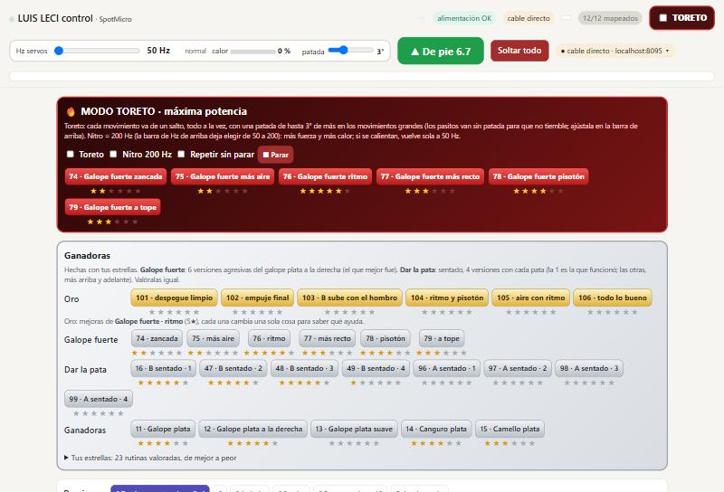</p>

---

## 13. Setting it up from scratch

On a Raspberry Pi with **Raspberry Pi OS Lite 32-bit (Trixie)**:

1. Copy the repo to `~/spotmicro`, enable I2C (`sudo raspi-config nonint do_i2c 0`) and create the environment:
   `python3 -m venv --system-site-packages ~/robot && ~/robot/bin/pip install adafruit-circuitpython-servokit`.
2. Check the board: `sudo i2cdetect -y 1` must show `40` (if every address shows up, a wire is bad, usually GND).
3. Services: copy `web/spotmicro-web.service`, `pantalla/spotmicro-pantalla.service`,
   `sistema/spotmicro-led.service` and `sistema/spotmicro-vigilante.{service,timer}` to `/etc/systemd/system/`,
   `pantalla/pam-spotmicro-pantalla` to `/etc/pam.d/spotmicro-pantalla`, then
   `sudo systemctl disable getty@tty1 && sudo systemctl enable --now spotmicro-web spotmicro-pantalla spotmicro-led spotmicro-vigilante.timer`.
   (Paths assume the user `luislecinana`: change them otherwise.)
4. Network: `sistema/red_prueba.sh` creates the `spotmicro-eth0` profile (DHCP + 169.254.42.1 + fixed IPv6).
5. Optional, the web app on the TV: `sudo sistema/instala-navegador.sh` (needs internet, resumable).
6. Map the servos in the web app (Probar, channel by channel), pick the standing pose ✓ and fine-tune the legs.

---

## 14. Testing without the robot

A PCA9685 simulator (`pruebas/fake/`) lets you start the server and run the tests without moving anything:

```
FAKE_LOG=/tmp/fake.log SPOTMICRO_PORTS=8095 SPOTMICRO_FAST=1 PYTHONPATH=pruebas/fake python3 web/server.py &
BASE=http://127.0.0.1:8095 FAKE_LOG=/tmp/fake.log python3 pruebas/prueba_servidor.py     # → TODO BIEN (all good)
```

The screenshots on this page were taken that way, with the server in a container and simulated servos.
`pruebas/ver_panel.py` and `pruebas/ver_selector.py` print the TV dashboard as text.

---

## 15. Lessons, problems and what's left

**Problems along the way** (and how they were solved): a badly inserted SD card and boot loops from the charger · the
Pi shutting down abruptly from lack of power (charger, cable and the terminal's GND) · a PCA9685 burned by a short
circuit · A's elbow not responding on channel 0 (moved to 1) · B3's horn mounted 3 teeth off · servos moving one by one
couldn't lift the body · Toreto shaking because of a too-large kick · CRLF line endings sneaking in from Windows.

**What's left** (details in [`docs/ESTADO.md`](docs/ESTADO.md), Spanish):
- Fully fix the Pi's power; re-seat B3's horn; check or replace D3's servo.
- Rate the gold routines (101-106) and cross the best ones; a straight gait with turn control from the TV.
- A 6 V servo supply; an INA219 to measure current; WiFi (NodeMCU over SLIP, or a USB WiFi dongle as an access
  point); use the HC-SR04s as eyes.

---

## 16. Safety

- The web app has **no password**: use it only on your local network or over a direct cable.
- The servos run from **their own supply** (5-6 V, ≥10 A) on the PCA9685 terminal, never from the Pi, with a common GND.
- Always test **with the robot in the air** first.
- Don't raise the Hz or remove the heat protection: MG996R servos are analog and can burn out.
- Shut down with the **Apagar la Pi** button (or `sudo poweroff`) and wait ~20 s before unplugging, so the SD card survives.

---

## 17. Repository layout

| Folder / file | What it is |
|---|---|
| `web/server.py`, `web/index.html` | Server (standard-library Python + `adafruit-circuitpython-servokit`) and the full web app |
| `web/lite.html` | Lightweight web app for the TV |
| `web/static/blockly/` | Blockly 13.3.0 (Apache 2.0, see its `LICENSE`) |
| `web/static/esquema.svg` | Wiring diagram (generated by `sistema/gen_esquema.py`) |
| `pantalla/` | TV dashboard (curses), kiosk browser launcher, systemd unit and PAM |
| `sistema/` | Heartbeat LED, watchdog, browser installer, network test, name migration |
| `pruebas/` | Board simulator and server tests (they don't move anything) |
| `servo_map.json`, `poses.json`, `config.json` | This robot's data: map and offsets, poses, convention, ratings… |
| `docs/` | Status, routines, API, guide for working with AI, and this README's images |

---

<p align="center">
  
  
  
  
  
  
</p>

Made by **Luis** ([@Leci37](https://github.com/Leci37)) with **Iván**, by testing on the robot and rating with stars,
with help from AI assistants. Inspired by the SpotMicro community, [mike4192/spotMicro](https://github.com/mike4192/spotmicro)
and [OpenQuadruped/spot_mini_mini](https://github.com/OpenQuadruped/spot_mini_mini).
