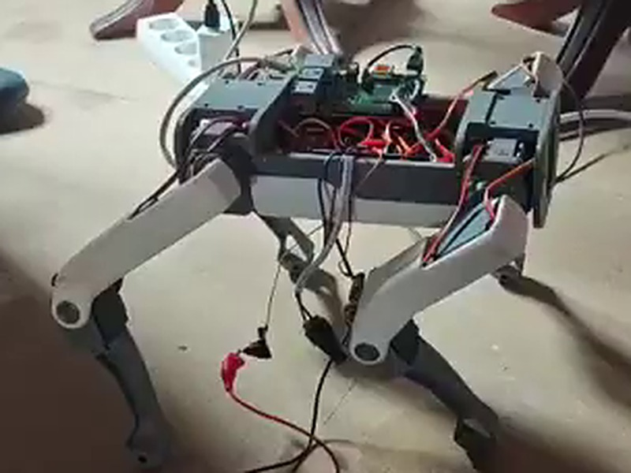
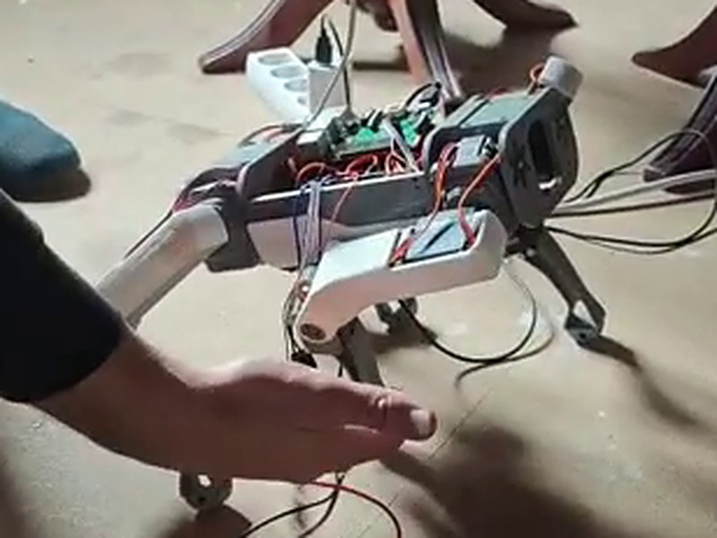

<p align="center"><b>🇪🇸 Español</b> · <a href="README.en.md">🇬🇧 English</a></p>

<h1 align="center">🐕 LUIS LECI control: SpotMicro con Raspberry Pi 2</h1>

<p align="center"><b>Un perro robot cuadrúpedo (clon de SpotMicro impreso en 3D) que se pone de pie, anda al galope, da la pata
y pide el autobús, manejado desde una web y desde la tele, sin internet.</b></p>

<div align="center">
<table>
  <tr>
    <td colspan="3" align="center"><a href="https://youtu.be/Hf6u9rh6BYM"></a></td>
  </tr>
  <tr>
    <td align="center"><a href="https://youtu.be/Hf6u9rh6BYM"></a><br><sub><b>1 · Se levanta</b></sub></td>
    <td align="center"><a href="https://youtu.be/Hf6u9rh6BYM"></a><br><sub><b>2 · Menea el culo</b></sub></td>
    <td align="center"><a href="https://youtu.be/Hf6u9rh6BYM"></a><br><sub><b>3 · Da la pata</b></sub></td>
  </tr>
  <tr>
    <td colspan="3" align="center"><a href="https://youtu.be/Hf6u9rh6BYM"></a></td>
  </tr>
</table>
</div>

---

## Índice

0. [Para quien siga el proyecto (personas e IA)](#0-para-quien-siga-el-proyecto-personas-e-ia)
1. [Qué es y qué hace](#1-qué-es-y-qué-hace)
2. [Hardware](#2-hardware)
3. [Esquema de conexiones y alimentación](#3-esquema-de-conexiones-y-alimentación)
4. [Conectarse al robot](#4-conectarse-al-robot)
5. [Patas y articulaciones: cómo localizar cada una](#5-patas-y-articulaciones-cómo-localizar-cada-una)
6. [Pruebas y calibración (±5, ±15, ±30…)](#6-pruebas-y-calibración-5-15-30)
7. [Ponerse de pie](#7-ponerse-de-pie)
8. [Rutinas, marchas y estrellas](#8-rutinas-marchas-y-estrellas)
9. [Programar con bloques (tipo Scratch)](#9-programar-con-bloques-tipo-scratch)
10. [La tele (HDMI)](#10-la-tele-hdmi)
11. [Métricas: consumo en tiempo real y cortes de corriente](#11-métricas-consumo-en-tiempo-real-y-cortes-de-corriente)
12. [Modo Toreto y barra de Hz](#12-modo-toreto-y-barra-de-hz)
13. [Puesta en marcha desde cero](#13-puesta-en-marcha-desde-cero)
14. [Probar sin robot](#14-probar-sin-robot)
15. [Lo aprendido, problemas y lo que falta](#15-lo-aprendido-problemas-y-lo-que-falta)
16. [Seguridad](#16-seguridad)
17. [Estructura del repositorio](#17-estructura-del-repositorio)

---

## 0. Para quien siga el proyecto (personas e IA)

> **¿Vas a seguir el proyecto con una IA (GPT, Claude, Codex…)?** Empieza aquí: dale `AGENTS.md` y `docs/ESTADO.md`.

- [`AGENTS.md`](AGENTS.md): **léeme primero**. Resumen autosuficiente con las reglas de oro, cómo llegar, la
  arquitectura y cómo trabajar sin romper nada (sirve para pegarlo en GPT, Claude, Codex…).
- [`docs/ESTADO.md`](docs/ESTADO.md): dónde estamos y a dónde vamos, y lo aprendido con las estrellas.
- [`docs/RUTINAS.md`](docs/RUTINAS.md) · [`docs/API.md`](docs/API.md) · [`docs/USAR-CON-GPT.md`](docs/USAR-CON-GPT.md).
- [`AYUDA.md`](AYUDA.md): la guía de uso (también en la web, en `/ayuda` y en la tele con la tecla H).
- [`CLAUDE.md`](CLAUDE.md): el contexto técnico largo y el **registro con fechas** de todo lo que se ha hecho.

---

## 1. Qué es y qué hace

Un SpotMicro heredado a medio montar, puesto en marcha con una **Raspberry Pi 2** (sin WiFi), una placa de servos
**PCA9685** y **12 servos MG996R**. Todo el software corre en la Pi y se maneja desde:

- 🌐 **Una web** (`http://<ip-de-la-pi>`): mapear y calibrar los servos, mover patas, posturas, **80+ rutinas**
  (de pie, galopes, dar la pata…), estrellas para valorarlas, modo Toreto, barra de Hz, programación por bloques,
  consumo en tiempo real y un informe del estado.
- 📺 **La tele por HDMI** con un teclado: panel de texto con todo el estado, **P** = de pie, rutinas por número, o la
  web ligera en modo kiosco.
- 🔌 **Sin internet ni router**: con un cable de red directo al portátil la Pi siempre está en `169.254.42.1`.
- 🛡️ **A prueba de cortes de corriente**: registro de arranques y apagones, escrituras atómicas, watchdog y LED de vida.

| Lo que ya hace | Código en la tele |
|---|---|
| Ponerse de pie (variante 6.7, la elegida) | **P** o 10 |
| Dar la pata sentado (la B y la A, 4 versiones) | 16, 47-49 · 96-99 |
| Pedir el autobús: pata arriba del todo y "ti-ti-ti" | 120, 121 |
| Galope fuerte · ritmo (la que mejor anda, 5★) | 76 |
| Galopes, camellos, canguro, caballo de tiro, de lado… | 11-15, 30-46, 74-79, 101-106 |
| Aires del caballo: paso, tölt, piaffe, passage… | 63-69 |
| Curiosas: baile, menear el culete, hacer pis, desperezarse | 80-84 |

---

## 2. Hardware

| Pieza | Detalle |
|---|---|
| Raspberry Pi 2 Model B v1.1 | armv7l, 1 GB, sin WiFi ni Bluetooth, alimentada por micro USB (5,1 V · 2,5 A) |
| PCA9685 | 16 canales PWM por I2C (bus 1, dirección 0x40); una se quemó y se cambió por la de repuesto |
| 12 servos MG996R | analógicos, 3 por pata; pensados para 50 Hz |
| Fuente de los servos | **5 V · 20 A** (la de 5 A se quedaba corta); mejor a 6 V para ganar ~15 % de fuerza |
| Condensador | 1000 µF en la clema V+/GND de la PCA9685 |
| Tele por HDMI + teclado USB | panel de texto y web en kiosco |
| En la bolsa (sin usar aún) | 2 × HC-SR04 (los "ojos" del SpotMicro), HC-05 Bluetooth, LCD 1602A, NodeMCU ESP8266, PCA9685 de repuesto |

---

## 3. Esquema de conexiones y alimentación


**De la Pi a la PCA9685** (lógica, 3,3 V): VCC → pin 1 · SDA → pin 3 · SCL → pin 5 · GND → pin 6.
**De la fuente de los servos a la clema V+/GND** de la PCA9685, con el GND común. Cada conector de servo, de dentro
hacia el borde: señal (naranja) · V+ (rojo) · GND (marrón).

Reglas que se aprendieron por las malas:
- 🔴 **El GND de la fuente de los servos, siempre a la clema y bien apretado.** Con mal contacto, la corriente de los
  servos vuelve por la Pi y su cable micro USB, y lo quema (pasó).
- 🔴 **La Pi necesita su propio cargador** de 5,1 V y 2,5 A con cable corto. Con uno flojo se reinicia en bucle o se
  apaga de golpe al mover servos.
- 🔴 **Nunca** cambiar conectores con todo encendido, alimentar otra placa desde la clema de los servos (así se quemó
  la primera PCA9685) ni enchufar el cable Schuko de 230 V que venía metido en la clema.

---

## 4. Conectarse al robot

| Situación | Cómo |
|---|---|
| Cable de red directo del portátil a la Pi | Windows se pone una IP 169.254.x.x solo → **`http://169.254.42.1`** · `ssh <usuario>@169.254.42.1` |
| Con router (el 4G Huawei) | por DHCP, normalmente `http://192.168.8.104` |
| Último recurso | IPv6 de enlace local fija: `ssh -L 8080:localhost:8080 <usuario>@fe80::ba27:ebff:fe16:ec15%<interfaz>` → `http://localhost:8080` |
| En la propia Pi | la tele por HDMI (panel o web en kiosco) |

La web sale por los puertos 80 y 8080. La pestaña **"estado"** (arriba a la derecha) dice por dónde estás entrando,
las IP, los comandos SSH y las rutas. El perfil de red (`spotmicro-eth0` de NetworkManager) mantiene `169.254.42.1`
siempre, haya router o no, y un **vigilante** lo repone cada minuto si algo falla.

---

## 5. Patas y articulaciones: cómo localizar cada una

Vistas **desde arriba con la cabeza delante**: **A** delantera izquierda · **B** delantera derecha · **C** trasera
derecha · **D** trasera izquierda. Cada pata, del cuerpo al suelo: **1 pectoral** (abre y cierra la pata hacia el
lado) · **2 hombro** (la lleva adelante y atrás) · **3 codo** (dobla la parte de abajo). Así, **B3** es el codo de B.

| Pata | 1 pectoral | 2 hombro | 3 codo |
|---|---|---|---|
| A delantera izq | canal 4 | 2 | 1 |
| B delantera der | 5 | 3 | 6 |
| C trasera der | 10 | 12 | 14 |
| D trasera izq | 11 | 13 | 15 |


**Para saber qué servo es cada canal**: botón **Probar** en su tarjeta (el servo se mueve ±10° y vuelve). Si mueves
algo a mano, la sección **"El robot en vivo"** dibuja lo que cree la Pi y pregunta "¿está así de verdad?"; si una
articulación va al revés, se invierte con un clic.


**Ángulos.** La web trabaja con el ángulo **lógico** (30-150°). El que recibe el servo es el lógico más su **ajuste**
de calibración, entre 5 y 175°. Las patas derechas van **en espejo** (180 − ángulo), y el sentido de cada articulación
se encontró probando 8 combinaciones: la buena fue la "variante 6" (hombro −, codo +, delanteras invertidas).

---

## 6. Pruebas y calibración (±5, ±15, ±30…)

Cada canal tiene su tarjeta con **Probar**, **Soltar**, botones **−30 −15 −5 +5 +15 +30**, un deslizador y
**Calibrar** (fijar aquí = 90°, invertir, quitar ajuste). Hay grupos ("todos los pectorales / hombros / codos", con
espejo en las derechas), "Bloquear todo donde está" con barra de progreso y la memoria de la última posición.


**Afinar patas**: con el robot de pie, cada pata se compara con su pareja (A con B, D con C) y se corrige ±1/±5. El
servo se mueve en el momento y el ajuste vale para todas las posturas y rutinas. Ajustes actuales: A1 +10, A3 −15,
B1 −15, B3 +50 (horn mal puesto: llega a su tope), C1 −5, C3 −10, D3 −22.


---

## 7. Ponerse de pie

Levantar el cuerpo con servos justos de fuerza tiene truco: si los servos se mueven de uno en uno, cada pata carga
sola con su esquina y no puede. La rutina de pie **recoge las 4 patas a la vez y las estira a la vez**, 1° cada vez y
despacio. La elegida es la **6.7** (agachado 30, pectorales +5), con un botón grande **▲ De pie** arriba y la tecla
**P** en la tele (para lo que esté en marcha y se pone de pie).

Variantes para probar: 6, 6.1 (baja), 6.2 (alta), 6.3/6.4 (inclinadas), 6.5/6.6 (pectorales), y las **de pie suaves**
(a escalones, en dos tiempos, y la "de Iván": delanteras y traseras alternando, nunca las 4 a la vez). La pata D es la
más débil, así que acaban con un "toquecito" a su codo.

---

## 8. Rutinas, marchas y estrellas


- **Motor de marchas por fases** (como los SpotMicro de GitHub y los aires del caballo): cada pata tiene su momento en
  el ciclo; mientras apoya empuja de delante a atrás y en el aire vuelve en arco. Con **pisada firme** (el pie aprieta
  contra el suelo, la "penetration depth" de spot_mini_mini), despegue limpio, empuje final…
- **Velocidad** en 6 marchas (1ª muy lenta a 6ª turbo), cambiable con la rutina en marcha. **Repetir sin parar** en cada rutina.
- **Estrellas de 0 a 6**: Luis valora cada rutina al probarla y las siguientes se diseñan cruzando las mejores y
  cambiando una sola cosa cada vez (un aprendizaje por refuerzo hecho a mano). Lo que salió:
  - Anda lo de la **familia del galope** (patas en orden D, C, A, B), mejor con las patas rectas y la pisada fuerte.
  - Va mejor la **zancada asimétrica** (izquierdas largas, derechas cortas).
  - **De pie, levantar una delantera tumba al robot**, porque el peso va delante. **Sentado** funciona: de ahí "Dar
    la pata sentado" y "Pedir el autobús".
- **Cajas de colores**: oro (mejoras de la mejor), plata (las ganadoras y "Dar la pata sentado"), rojo (Toreto),
  fucsia (autobús), amarillo y rosa (de pie suaves), verde (nuevas) y azul (curiosas).

Detalle del motor y de cómo añadir una rutina: [`docs/RUTINAS.md`](docs/RUTINAS.md).

---

## 9. Programar con bloques (tipo Scratch)

Blockly 13.3.0 servido desde la propia Pi (funciona sin internet), en español: mover pata o articulación, posturas,
esperar, velocidad, repetir, llamar a otra rutina… Los programas se guardan como rutinas y se lanzan también desde la
tele (teclas 1-9). Cualquier rutina generada se puede abrir en bloques para verla o modificarla.


---

## 10. La tele (HDMI)

Al arrancar sale un **menú de 15 s**: [1] panel de texto · [2] la web en kiosco (cage + chromium) · [3] consola.
El **panel** muestra las 16 salidas con su pulso, la conexión, la alimentación, el consumo, la rutina en marcha y las
populares; se maneja con el teclado:


**P** de pie · **0 / Intro** rutinas por número (populares primero, colores por familia y estrellas) · **R** repetir
sin parar · **+ / −** velocidad · **F** Toreto · **N** Nitro · **, .** Hz · **X** parar · **S** soltar todo ·
**H** ayuda · **A/B** apagar o reiniciar.


La **web ligera** `/lite` (la que abre el navegador de la tele) tiene lo esencial en grande:


---

## 11. Métricas: consumo en tiempo real y cortes de corriente

- **Consumo estimado por servo**, cada segundo, en la cabecera (gris suelto · ámbar sujetando ~0,3 A · rojo
  moviéndose ~1,2 A) y en la tele, con el **límite de la fuente** (fuente vieja 5 A / nueva 20 A): con poca fuente
  mueve los servos por tandas.
- **Calor estimado de los servos** con la barra de Hz.
- **Apagados de golpe**: franja con cada corte (por falta de corriente o no), sacada del journal persistente y de
  `energia.log`, que apunta cada arranque y cada caída de tensión.
- **Informe para la mudanza**: comprueba servicios, red, alimentación, SD, placa, mapa y git de un vistazo.


Es una **estimación**: para medir de verdad haría falta un sensor (p. ej. INA219).

---

## 12. Modo Toreto y barra de Hz

**Toreto** ("máxima potencia, como en Fast and Furious"): cada movimiento va de un salto, todo a la vez, con una
**patada** ajustable de unos grados más allá del objetivo para que el servo meta toda su fuerza. La patada solo se da
en los movimientos grandes (en los pasitos de las marchas hacía temblar al robot).

**Barra de Hz (50-200)**: más hercios dan más fuerza y más calor. La Pi **estima el calor** de los servos: sube mientras
sujetan por encima de 60 Hz y baja a 50 Hz. Si llega al 100 %, **vuelve sola a 50 Hz** y no deja subir hasta que se
enfríen. Tampoco sube con la Pi en falta de corriente.

<p align="center"></p>

---

## 13. Puesta en marcha desde cero

En una Raspberry Pi con **Raspberry Pi OS Lite 32-bit (Trixie)**:

1. Copia el repo en `~/spotmicro`, activa I2C (`sudo raspi-config nonint do_i2c 0`) y crea el entorno:
   `python3 -m venv --system-site-packages ~/robot && ~/robot/bin/pip install adafruit-circuitpython-servokit`.
2. Comprueba la placa: `sudo i2cdetect -y 1` debe mostrar `40` (si salen todas las direcciones, falla un cable, casi
   siempre el GND).
3. Servicios: copia `web/spotmicro-web.service`, `pantalla/spotmicro-pantalla.service`,
   `sistema/spotmicro-led.service` y `sistema/spotmicro-vigilante.{service,timer}` a `/etc/systemd/system/`,
   `pantalla/pam-spotmicro-pantalla` a `/etc/pam.d/spotmicro-pantalla`, y
   `sudo systemctl disable getty@tty1 && sudo systemctl enable --now spotmicro-web spotmicro-pantalla spotmicro-led spotmicro-vigilante.timer`.
   (Las rutas asumen el usuario `luislecinana`: cámbialas si no.)
4. Red: `sistema/red_prueba.sh` crea el perfil `spotmicro-eth0` (DHCP + 169.254.42.1 + IPv6 fija).
5. Opcional, la web en la tele: `sudo sistema/instala-navegador.sh` (necesita internet, es reanudable).
6. Mapea los servos en la web (Probar, canal a canal), elige la de pie ✓ y afina las patas.

---

## 14. Probar sin robot

Un simulador de la PCA9685 (`pruebas/fake/`) deja arrancar el servidor y pasar las pruebas sin mover nada:

```
FAKE_LOG=/tmp/fake.log SPOTMICRO_PORTS=8095 SPOTMICRO_FAST=1 PYTHONPATH=pruebas/fake python3 web/server.py &
BASE=http://127.0.0.1:8095 FAKE_LOG=/tmp/fake.log python3 pruebas/prueba_servidor.py     # → TODO BIEN
```

Las capturas de este README están hechas así, con el servidor en un contenedor y los servos simulados.
`pruebas/ver_panel.py` y `pruebas/ver_selector.py` muestran el panel de la tele como texto.

---

## 15. Lo aprendido, problemas y lo que falta

**Problemas que hubo** (y cómo se resolvieron): SD mal metida y reinicios en bucle por el cargador · la Pi apagándose
de golpe por falta de corriente (cargador, cable y el GND de la clema) · una PCA9685 quemada por un cortocircuito ·
el codo de A que no respondía en el canal 0 (pasado al 1) · el horn de B3 montado 3 dientes girado · los servos uno a
uno no podían levantar el cuerpo · Toreto temblando por una patada demasiado grande · saltos de línea CRLF colados
desde Windows.

**Lo que falta** (detalle en [`docs/ESTADO.md`](docs/ESTADO.md)):
- Arreglar del todo la alimentación de la Pi; recolocar el horn de B3; revisar o cambiar el servo de D3.
- Valorar las rutinas de oro (101-106) y cruzar las mejores; una marcha recta con mando de giro desde la tele.
- Fuente de servos a 6 V; un INA219 para medir la corriente; WiFi (NodeMCU con SLIP o un USB WiFi en modo punto
  de acceso); usar los HC-SR04 como ojos.

---

## 16. Seguridad

- La web **no tiene contraseña**: úsala solo en tu red local o por cable directo.
- Los servos van con **fuente propia** (5-6 V, ≥10 A) en la clema de la PCA9685, nunca desde la Pi, y con GND común.
- Prueba siempre **con el robot en el aire** primero.
- No subas los Hz ni quites la protección de calor: los MG996R son analógicos y se pueden quemar.
- Apaga con el botón **Apagar la Pi** (o `sudo poweroff`) y espera ~20 s antes de desenchufar: así no se estropea la SD.

---

## 17. Estructura del repositorio

| Carpeta / fichero | Qué es |
|---|---|
| `web/server.py`, `web/index.html` | Servidor (Python estándar + `adafruit-circuitpython-servokit`) y la web completa |
| `web/lite.html` | Web ligera para la tele |
| `web/static/blockly/` | Blockly 13.3.0 (Apache 2.0, ver su `LICENSE`) |
| `web/static/esquema.svg` | Esquema de conexiones (lo genera `sistema/gen_esquema.py`) |
| `pantalla/` | Panel de la tele (curses), lanzador del navegador kiosco, unidad systemd y PAM |
| `sistema/` | LED de vida, vigilante, instalador del navegador, prueba de red, migración de nombres |
| `pruebas/` | Simulador de la placa y pruebas del servidor (no mueven nada) |
| `servo_map.json`, `poses.json`, `config.json` | Datos de este robot: mapa y ajustes, posturas, convención, valoraciones… |
| `docs/` | Estado, rutinas, API, guía para trabajar con IA e imágenes de este README |

---

<p align="center">
  
  
  
  
  
  
</p>

Hecho por **Luis** ([@Leci37](https://github.com/Leci37)) con **Iván**, a base de probar en el robot y valorar con estrellas, y con la ayuda de
asistentes de IA. Inspiración: la comunidad SpotMicro, [mike4192/spotMicro](https://github.com/mike4192/spotmicro) y
[OpenQuadruped/spot_mini_mini](https://github.com/OpenQuadruped/spot_mini_mini).
